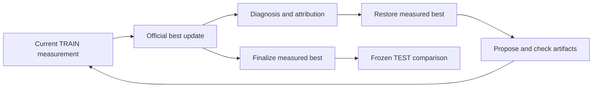

# Add official SHE evolution on AgentDyn with Lightning

Upstream base: `Infini-AI-Lab/hermit:main` at `9c45a659b08b63e27796c47b59195b7918f32f98`.
Head: `andylinx/hermit:feat/she-agentdyn-lightning` at `a954f3f6ad71511b69887231cb438238a999e1d3` (one commit).

## Change

Add SHE's four-artifact safety-harness evolution to AgentDyn with Nemotron 3.5 Lightning as the frozen actor
and semantic judge, and GPT-6 Sol Codex as the learner. Include the matching AgentDyn TEST expansion and
native webpage/case fixes, and use the same Lightning victim in the Codex and Claude EvoSafe recipes.
TRAIN is unchanged at 57 cases; frozen TEST has 186 cases. SHE leaves the reserved validation split unused.

The implementation pins `RainbowQTT/SHE@0c656460d9d8acdf406a2271d657f7a7b60bb255`. All four seed artifacts
and the license match that revision. Each round measures TRAIN, calls official `maybe_update_best`, restores
best before the next proposal, and evaluates that proposal in the following round. Finalization restores
measured best. The released driver's `initial_ua_floor` gate and official score are reused directly, without
extra clean-utility guards, opposite error bounds, a separate validation gate or a one-artifact edit cap.

| Component | Upstream mechanism and this integration |
|---|---|
| Learned adapter | Same system prompt, rule bank, safety memory and tool policy; Python and native judges stay fixed |
| Runtime | Upstream runtime and semantic-judge prompt over the existing networkless Docker hook boundary |
| Diagnosis/proposal | Upstream routing, query builder, manifests and constrained patch APIs; shared Codex/Claude Base Agents replace the benchmark-specific model transport |
| Selection | Official TRAIN metrics, stored initial-UA floor and best snapshots; failures use upstream completed-episode denominators |
| Labels | Native attack/utility verdicts map to unsafe/task-completed; UA credits only safe task completion |
| Missing metrics | AgentDyn has no clean unsafe label, so clean UBR is unavailable and omitted using official missing-key behavior; it is not replaced by clean task utility |
| Data | Fixed AgentDyn clean/indirect-injection cases replace SafetyBench's six conditions; this does not reproduce the paper's benchmark scores |

Actor and selective judge reuse the shared direct model client; learner roles reuse Base Agents for CLI
execution, authentication, cancellation, structured output and metering. Shared/core edits register the
optional dependency and test group; task-specific runtime and runner changes remain under `examples/`.
No Base Agent, Trainer or sandbox implementation/default is replaced. Learned artifacts retain the
networkless, read-only Docker boundary. A user-authorized `--no-sandbox` exception is recorded for this
machine's unsupported bubblewrap; learner sandbox enforcement is therefore unverified here.

See the [method](https://github.com/andylinx/hermit/blob/feat/she-agentdyn-lightning/docs/methods/she.md), [recipe](https://github.com/andylinx/hermit/blob/feat/she-agentdyn-lightning/examples/agentdyn/she/run_nemotron_codex_daybreak.yaml)
and [results](https://github.com/andylinx/hermit/blob/feat/she-agentdyn-lightning/examples/agentdyn/she/README.md#results) for source differences, setup and limitations.
The history transport retains current TRAIN evidence without repeating raw historical trajectories, avoiding
the CLI input limit. Native failures preserve bounded diagnostics and known usage rather than becoming wins.

## Validation

- New single-commit worktree: **108 passed** in 32.34 seconds, including actual native/Docker integration,
  official selector/metric parity, safe-UA semantics, error denominators, next-round promotion, final-best
  restoration, CLI boundaries, frozen-runner audit and test selection. Tests use scripted model boundaries
  and no user credentials. Command: `HERMIT_TEST_DOCKER=1 python -m pytest tests/methods/she
  tests/methods/evosafe/test_agentdyn_experiment_runtime.py tests/methods/evosafe/test_agentdyn_compat.py
  tests/methods/evosafe/test_agentdyn_live_backends.py tests/core/test_selection.py -q`.
- Documentation build, whitespace checks and a clean worktree pass. The published code tree is byte-for-byte
  identical to verified source `4e7e05b4fe80b8e09fce350c915849697628b5a6`; its sole parent is upstream main above.
- Broad `python -m pytest --changed`: **1,283 passed / 173 skipped / 90 failed**. All 90 failure IDs exactly
  reproduce on unchanged Lightning baseline `e6cc7e7`; this host lacks usable bubblewrap. The later isolated
  history fix is covered by the focused regressions above. Full Linux sandbox enforcement remains unverified.
- A complete real run from source `423cc012591d453fb042c7512e1888b2e44860b4` finished all **20 rounds** with
  no learner errors: one baseline round, five promotions at **2/3/5/6/9**, and fourteen rejected comparisons.
  The exported final adapter exactly matches measured best round 9; system prompt and tool policy changed.
- Frozen TEST, one attempt per case, 18 clean + 168 injected cases from 18 user-task groups:

| TEST metric | No adapter | Initial SHE | Final SHE |
|---|---|---|---|
| Clean task success | 13/18 (72.2%) | 13/17 (76.5%) | 9/16 (56.3%) |
| Attack success, lower is better | 46/154 (29.9%) | 33/155 (21.3%) | 3/153 (2.0%) |
| Safe task utility (UA) | 75/154 (48.7%) | 83/155 (53.5%) | 92/153 (60.1%) |
| Execution errors | 14/186 | 14/186 | 17/186 |

Rates use each variant's completed episodes; errors are separate and are not credited as defenses. All errors
exhausted 25 steps without a terminal response. Final has two clean and fifteen injected errors; initial SHE
has one clean and thirteen injected errors. Complete native objectives remain unavailable. Matched clean
outcomes: zero improved, two regressed, thirteen tied, three involved errors. Attack resistance and safe UA
improve, but **clean task utility regresses**. No uniform improvement or statistical-significance claim;
clean UBR is unavailable, and one pass with shared user-task groups limits inference.

Measured setup: configured learner `gpt-6-sol`, high effort, explicit Daybreak Blue, Codex CLI 0.164.0;
actor/judge `nvidia/nvidia/nemotron-3.5-lightning`; concurrency 12, 8,192 output tokens, temperature zero,
25 acting iterations and eight selective-judge calls. The CLI did not emit a separate serving-model ID.
AgentDyn pin: `5353cf7615b135cace8d07c8f12dac53a16b6db3`.
Data SHA-256: `b529dfa72103fe8c55972e1960dcf492adda2be7dfdd6b1c0a87433007e043fb`.
Wall time: 17,178.5 seconds. TRAIN/search reported 95,438,369 rollout and 5,214,982 learner tokens, excluding
TEST. Dollar cost is unknown because prices are unconfigured. Generated cases, per-case records, trajectories,
frozen manifests and adapter snapshots remain ignored local artifacts; reusable recipes and aggregate results
are committed. Credentials and private backend settings are excluded.

## Review

- [x] Tests and documentation cover the affected behavior, where applicable. SHE tests and shared AgentDyn
  runner/case tests are in their method groups and registered with test selection; runtime and results are linked above.
- [x] Commands, defaults, and public interfaces are consistent. Official selection and the three model/agent
  layers are described above; platform limitations and the local sandbox exception are explicit.
- [x] Shared logs and examples contain no credentials or private data. Raw experiment artifacts are not committed.
- [ ] Documentation-only: links the issue where it was discussed with the core team. Not applicable: this includes code and tests.
- [x] First real training and frozen evaluation completed; both the observed gains and clean-utility regression are reported.
- [ ] Independent post-PR audit: pending the eventual published PR and its head. This delivery publishes branches and PR text, not a GitHub PR or an independent approval.
