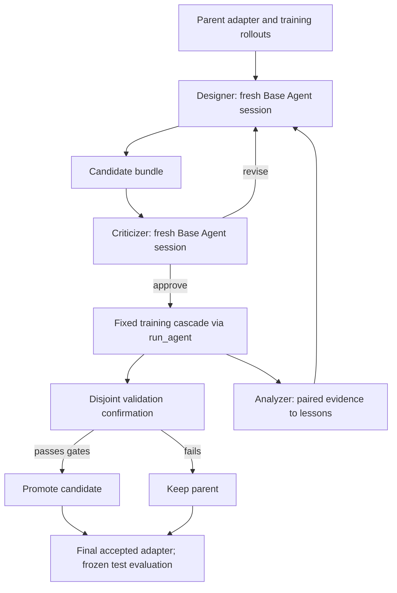

# EvoSafeHarness

EvoSafeHarness ([paper](https://andylinx.github.io/EvoSafeHarness/assets/EvoSafeHarness_paper.pdf),
[code](https://github.com/SaFo-Lab/EvoSafeHarness), [website](https://andylinx.github.io/EvoSafeHarness/))
secures a tool-using agent without changing its model. It keeps the victim model frozen and searches a **defense
bundle** around it: a system-prompt surface (`ADAPTER.md`) and executable tool-call hooks (`defense.py`). Each
candidate is written from the victim's own failure traces and kept only when it measurably improves
`utility − ASR`. Four parts run the search: a **Designer** proposes one mechanism, an independent **Criticizer**
reviews it, a **Cascade** scores it, and an **Analyzer** turns the results into lessons for the next proposal.

In Hermit the method is the `evosafe` Evolver with the `evosafe@1.0` template. It does not depend on any benchmark:
a domain plugs in through the [task contract](#the-task-contract). The first domain is
[AgentDyn](https://github.com/SaFo-Lab/AgentDyn), in
[`examples/agentdyn/`](https://github.com/Infini-AI-Lab/hermit/tree/main/examples/agentdyn).

| Layer | Where |
|---|---|
| Method (Evolver, roles, gates, task contract, hook SDK) | `hermit/agent/evolver/methods/evosafe/` |
| Defense bundle template | `hermit/adapter/templates/evosafe/` |
| AgentDyn integration (environment bridge, victim, judge, case preparation) | `examples/agentdyn/utils/` |
| EvoSafe run configs on AgentDyn | `examples/agentdyn/evosafe/` |

## Setup

```yaml
template: evosafe@1.0
agent: {name: ../utils/bridge.py:run, base: direct, model: vllm/nvidia/llama-3.3-nemotron-super-49b-v1.5}                # the domain's hook bridge
judge: {path: ../utils/judge.py}                    # native verdicts as metrics in JudgeResult.extra
evolver:
  name: evosafe
  base: claude
  claude: {web_search: false, timeout_s: 1500}
  params:
    search_mode: roles
    gate_mode: source
    cascade_sizes: [12, 57]
    eval_task_ids: [...]                             # training cases
    robustness_task_ids: [...]                       # validation cases
```

A full config is [`examples/agentdyn/evosafe/run_nemotron_claude.yaml`](https://github.com/Infini-AI-Lab/hermit/tree/main/examples/agentdyn/evosafe/run_nemotron_claude.yaml).
The method does not generate attacks; it replays existing frozen cases.

## Agent layers

The AgentDyn Acting Agent keeps its native task/tool loop in `examples/agentdyn/utils/bridge.py`. Every victim
turn, including the optional frozen-model classifier, calls a `direct` Base Agent; its Layer 1 is Hermit's
`ChatClient` with the resolved backend, request timeout, retries and price. AgentDojo's message converters are
reused, but the OpenAI SDK no longer sends requests. Bare native AgentDyn model names without backend settings
are no longer accepted: configure `agent.base: direct` and `agent.model: <backend>/<model>`.

The Evolver keeps Designer/Criticizer/Analyzer orchestration and all selection gates in Layer 3. Each role calls
`make("claude" | "codex", settings).run(...)` with an empty framework tool set and a fresh session. Base Agents
own process cleanup, cancellation, timeouts, configuration, login-plan scheduling and usage. The role's JSON schema
is given to Codex as `--output-schema` and to Claude in the prompt, both through the Base Agent's existing settings,
and the reply is validated against it in Layer 3; a refusal is read from the reply and the trajectory's error
steps. The normalized trajectory of each role is archived. Claude's built-in tools are disabled (`--tools ""`);
Codex has web search disabled, a read-only sandbox by default, an ephemeral session, and instructions to use no
tools. Codex's read-only mode does not hide files; use the shared isolation settings for a filesystem boundary.

`evolver.base`, `evolver.model` and `evolver.claude`/`evolver.codex` are the preferred configuration. Legacy
`proposer`, `claude_model`/`codex_model`, binary and timeout settings remain accepted when the corresponding
shared setting is absent. For `proposer: llm`, the existing metered Trainer `llm` tool already calls `direct`.
No extra usage is added for that path; CLI usage is returned once in `StepResult`.

The method changes nothing in the Hermit core; [`FRAMEWORK_SUPPORT.md`](https://github.com/Infini-AI-Lab/hermit/blob/main/examples/agentdyn/evosafe/FRAMEWORK_SUPPORT.md) lists what could become shared
support later.

## The task contract

A domain provides four things:

1. **Case fields** on every task row: `kind` (`clean` or `injected`), and optionally `group` (the cases of one user
   task, kept in one split) and `domain` (a stratum for balanced evaluation).
2. **A judge** that returns `{kind, utility, attack_success}` as `metrics` in `JudgeResult.extra`, and raises
   for an episode the pipeline reports as failed (so the run is recorded as failed, with its usage and log).
   The defense metrics are computed from the run records by the method's `contract.py`.
3. **A hook bridge** as the task pipeline. It builds the bundle's `Defense` once per episode and calls its hooks
   around every tool call, as the template's `.hermit/EVOLVER.md` specifies. Hooks see the trusted instruction and
   public tool schemas, never task IDs, labels or judge state.
4. **A domain specification** in `task_info` (`README.md`, `tools.json`), which every role receives.

To add a domain, follow `examples/agentdyn/utils/` and copy the AgentDyn run config.

## The step

1. Hermit rolls the current bundle out on the step's training cases. These rollouts are the parent's score.
2. For up to `max_proposals` trials, the Designer writes one candidate. A fresh Criticizer reviews it, and a
   rejected candidate is revised up to `review_revisions` times before any evaluation.
3. An approved candidate is scored on the training cases. With `gate_mode: source`, the source method's gates
   apply:
   - an intermediate stage needs utility ≥ 0.7× and ASR ≤ 1.3× the parent's;
   - promotion needs a gain in `utility − ASR` above `min_improvement`;
   - validation needs an objective within `validation_tolerance` of the parent's.
4. The Analyzer records lessons for the next trial. A promoted candidate becomes the parent.



## Parameters

```{literalinclude} ../../hermit/agent/evolver/methods/evosafe/evolver.yaml
:language: yaml
```

## Integrating with Hermit

The training loop and the core are unchanged; the whole search runs inside one `Evolver.step()`. A defense
objective has separate denominators that a mean of scalar scores cannot express, so the judge's per-episode
verdicts travel in `JudgeResult.extra` and the method's `contract.py` computes the objective from run records.
`hermit eval`'s `mean_score` is therefore not a defense metric: report an evaluation with
`examples/agentdyn/utils/report.py` or `compare.py`. See [`FRAMEWORK_SUPPORT.md`](https://github.com/Infini-AI-Lab/hermit/blob/main/examples/agentdyn/evosafe/FRAMEWORK_SUPPORT.md).

## What it is not

- The original's adaptive and renamed-payload robustness probes are not ported. Validation replays fixed cases.
- DTAP seed bundles (DRIFT, CaMeL) need an explicit port to this hook contract.
- Hook code runs next to the domain's judge in the rollout process, so it is not isolated from it.

## Example

[`examples/agentdyn/evosafe/`](https://github.com/Infini-AI-Lab/hermit/tree/main/examples/agentdyn/evosafe) runs the
setup on AgentDyn: Llama-3.3-Nemotron-Super-49B as the victim, Claude Code roles, and all 55 eligible user groups.
Results on the 54 held-out test cases will be added once the first evaluation of this version has run.
