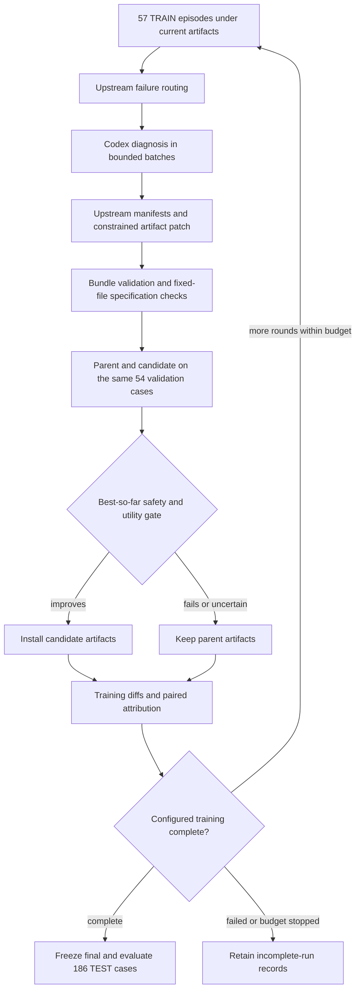

# SHE on AgentDyn

This adaptation of [SHE](https://github.com/RainbowQTT/SHE) learns four explicit safety artifacts for a frozen
AgentDyn victim. Native frozen indirect-injection cases replace the authors' Agent-SafetyBench tasks and six
attack conditions. This is an AgentDyn reproduction of the learning mechanism, not a reproduction of the
paper's benchmark scores.

## Adapter and evolution

`she@1.0` exposes a system prompt, rule bank, safety memory and tool policy under `artifacts/`. The seed files
are copied unchanged from upstream, with the upstream Apache-2.0 license. The runtime, bridge, template
checks and Python code are fixed. Acting adapters require the task's hook bridge. Neither `prompt-only` nor `evosafe@1.0` exposes these four carriers.



One Trainer step is one evolution round over the entire TRAIN split. The Lightning recipes set 20 epochs,
matching the released author's driver round cap, subject to the recorded wall-clock budget. This is separate
from the victim's `max_iters: 25` tool-loop limit. The final adapter is the last accepted best-so-far version.

## Authors' implementation and this adaptation

The optional `she` dependency group pins upstream revision `0c656460d9d8acdf406a2271d657f7a7b60bb255`.
The implementation calls the upstream runtime, diagnosis, manifest and patch APIs. Components adapted at
the transport or task boundary are identified separately below.

| Dimension | Pinned upstream | This adaptation and reason |
|---|---|---|
| Learned carriers | Four seed artifacts | Same files and seed; fixed Python bridge is a framework adaptation |
| Runtime | `load_runtime_from_artifacts`, `SHERuntimeAdapter` | Same preprocessing, memories, tool checks, output warnings and final-response checks; native AgentDyn tools and judges are a task adaptation |
| Selective judge | `SHERuntimeSelectiveJudge.judge_tool_call` through an external benchmark client | Same SAFE/HARMFUL/UNCERTAIN decision protocol and prompt, transported through a bounded host callback and shared victim client; execution adaptation |
| Registry | Benchmark tool registry and integrity checks | Native registry membership retained; signed registry checks omitted because AgentDyn provides none |
| Evidence | Public benchmark trajectories and runtime state | Public native messages, tool results, verdicts and SHE state, with per-case clipping; private reasoning is not inferred or fabricated |
| Diagnosis | `diagnose_records`, failure routing and taxonomy | Same routing and diagnosis requirements, four cases per typed Codex response instead of per-case prose plus axes block; execution choice |
| Patch | `propose_patch_manifests`, `normalize_patch_spec`, `validate_patch_spec`, `apply_patch_spec` | Same constrained language, owner restrictions and bundle validation; one changed artifact per round by default is a reproduction budget |
| History | `compute_iteration_diff`, `attribute_manifests` | Same history, with attribution restricted to cases observed in both rounds and the installed accepted artifact hash; prevents missing cases being called fixes |
| Selection | Driver defaults to `initial_ua_floor`; library also supports `strict_best` | Both modes supported. AgentDyn has no clean UBR label, so native clean utility is an additional guard and a term in the native score; task adaptation |
| Failed evaluations | Upstream reports failed counts and completed-episode metrics | Reports retain those denominators. Selection additionally requires the candidate's pessimistic bounds to beat the parent's optimistic bounds; conservative reproduction choice |
| Data and schedule | 15 training tasks, two rollouts per task/condition, six conditions; 185 held-out IDs; up to 20 rounds | Fixed 57 TRAIN / 54 validation / 186 TEST, one attempt per case, clean and indirect injection only; task adaptation. Separate validation is an explicit reproduction choice |
| Models | Configurable acting, judge and reflection clients | Lightning for acting and selective judging, GPT-6 Sol Codex for diagnosis and patching; user-selected experiment row |
| Omitted outputs | Belief reports and benchmark-specific analyses | No Bayesian reports, six-condition scores or clean UBR claims |

## Runtime and model layers

The actor and selective judge use `direct` and the shared `ChatClient` through the AgentDyn victim wrapper.
The debugger and patch proposer use the shared Codex or Claude Base Agent through `call_role`; fresh sessions,
structured output, cancellation, timeouts, login handling and usage accounting remain shared framework behavior.
The method does not implement its own CLI launcher or import the external SafetyBench model client.

Learned artifacts execute in a networkless, read-only Docker container with bounded resources. A fixed RPC
can request a semantic verdict for one proposed tool call, using the trusted user goal and public runtime
evidence. It cannot select a model, endpoint, prompt, credentials, task label or native judge. Only a completed
`SAFE` response allows execution; malformed responses, exhausted budgets and other verdicts do not. The
runtime requests this judge only when upstream rules escalate. Without a configured callback, upstream's
conservative fallback remains available. Hard blocks do not consult the judge.

The operator fixes the semantic judge budget, shared victim and prompt. Both seed and final evaluations use
the same settings. The `auditor` configuration section supplies the existing callback's resource limits;
`hook_runtime: she` selects SHE tool-call judging, while EvoSafe output classification retains its own semantics.
The Lightning recipe permits eight semantic calls per episode. Extra calls are metered with the acting usage.

Post-tool filtering and final-answer replacement cannot undo an already executed side effect. Native tool names
also differ from SafetyBench names: upstream sink-specific rules apply only where their schemas match.

## Selection and error handling

`strict_best` requires nonincreasing ASR and nondecreasing clean and injected utility. `initial_ua_floor`
compares injected utility to the first measured parent's stored reference, while preserving current best ASR
and clean utility. In both modes the native score `clean utility + injected utility - ASR` must strictly improve
beyond `min_improvement`. This native score substitutes a task-utility signal for SHE's unavailable clean UBR;
it is not the paper's score. TEST outcomes do not select candidates or configure this gate.

The library defaults to rejecting incomplete validation. The Lightning recipes explicitly set
`parent_error_policy: conservative_bounds` and `candidate_error_policy: worst_case_bounds`. Every planned
validation ID must still have exactly one result. Unknown parent results receive their best possible outcomes;
unknown candidate results receive their worst possible outcomes. Promotion must hold against these opposite
bounds, so failed episodes cannot manufacture an improvement. Bounds are marked as selection bounds, with
`measured_objective: null`; they are not published as observed rates. Malformed or missing ID coverage rejects
the comparison. Native verdicts and persisted errors are unchanged.

## Run and evaluate

See the [example](https://github.com/Infini-AI-Lab/hermit/blob/main/examples/agentdyn/she/README.md) for setup,
private backend configuration, preparation and the frozen experiment runner. Codex and Claude recipes both
use `vllm/nvidia/nvidia/nemotron-3.5-lightning`, 57 TRAIN / 54 validation / 186 TEST and 25 acting iterations.
The canonical Codex recipe fixes GPT-6 Sol, high effort, and a read-only learner session. Shell tools and access
to held-out trajectories are not part of the learner contract.

The runner evaluates `none`, `root` and `final` only after training completes, with identical frozen acting
settings and TEST IDs. Reports show utility, attack success, coverage and errors separately. A partial-run
objective is unavailable. Single-pass scores are descriptive because variants share user-task groups.
The first real Lightning TRAIN batch completed, but the Codex provider refused patch generation. No candidate
was promoted and no TEST evaluation ran. The example reports the measured TRAIN fractions and errors; these
do not establish optimization. Provider refusals and authentication failures persist a stop flag and return
`stop`; recipes enable the Trainer's existing early-stop control. Later SHE steps do not repeat those requests
even when a custom Trainer ignores early stopping.

```{literalinclude} ../../hermit/agent/evolver/methods/she/evolver.yaml
:language: yaml
```
