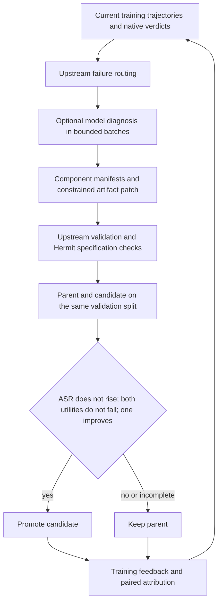

# SHE on AgentDyn

This adaptation of [SHE](https://github.com/RainbowQTT/SHE) evolves four explicit
safety artifacts for a fixed AgentDyn victim. It uses frozen indirect-injection
cases and native AgentDyn judges, rather than reproducing the authors'
Agent-SafetyBench experiments.

The `she@1.0` template exposes a system prompt, rule bank, safety memory and tool
policy. The existing prompt-only and EvoSafe templates do not provide this
four-artifact search space. The runtime bridge, template checks and Python code
are fixed; only `artifacts/` is learnable. The adapter is not plugin-portable: its
hooks require the task's runtime bridge.



## Upstream mapping

Upstream is pinned to `0c656460d9d8acdf406a2271d657f7a7b60bb255` in the `she`
dependency group. Seed artifacts are copied unchanged with their Apache-2.0
license. The implementation calls upstream runtime, taxonomy, failure routing,
manifests, patch validation and trajectory-diff functions.

| Dimension | Authors' implementation | This adaptation and reason |
|---|---|---|
| Learned object | Four safety artifacts | Same carriers and seed; Python remains fixed |
| Learning trigger | Evolution rounds | One patch per Trainer step; framework adaptation |
| Evidence | SafetyBench trajectories and safety labels | Training-only native AgentDyn trajectories/verdicts; task adaptation |
| Diagnosis | Per-case debugger and component routing | Upstream reasoning requirements and routing, with batched typed JSON replacing prose plus the separate axes block; execution adaptation |
| Candidate edits | Bounded artifact operations | Upstream patcher, restricted to diagnosed owners and a file budget |
| Selection | Safety/utility gates including clean UBR | Strict native ASR, clean utility and injected utility gate; AgentDyn has no UBR label |
| Runtime judge | Pluggable semantic judge | Conservative deterministic fallback; uncertain calls are blocked |
| Conditions | Clean and six benchmark settings | Clean and existing frozen indirect injections only; task adaptation |
| History | Cross-round evidence and attribution | Compare only cases observed in both rounds under the recorded promotion; missing cases are not fixes |
| Omitted features | Signed registry, belief reports, optional initial-UA floor | No signed AgentDyn registry; no Bayesian reports or alternate gate in this experiment |

The learner uses Hermit's shared CLI Base Agents. The Codex example uses a
read-only sandbox and `approval_policy="on-request"`; it does not require
`--yolo`. Runtime hooks run in a separate networkless Docker container, with
only the installed SHE library, fixed bridge and four artifacts mounted. Native
tools, judge predicates and provider credentials remain in the trusted worker.

## Setup and evaluation

Install the `she` dependency group together with the pinned AgentDyn checkout.
See the [example](https://github.com/Infini-AI-Lab/hermit/blob/main/examples/agentdyn/she/README.md) for environment setup,
the 57/54/54 grouped protocol, the frozen experiment runner and local outputs.
The no-adapter, seed and final adapters are evaluated on the same 54 held-out
cases after training. The acting model is Nemotron Super 49B v1.5; the learner
is configured independently. Failed episodes are reported separately and never
count as successful defenses. Provider cost is unknown when no price is set.

```{literalinclude} ../../hermit/agent/evolver/methods/she/evolver.yaml
:language: yaml
```

Post-tool filtering and final-answer replacement cannot undo an executed side
effect. Upstream sink rules apply only where AgentDyn tool names and argument
schemas match. These differences limit claims about effectiveness and parity.

The 2026-11-06 model-backed continuation completed eight diagnosis batches but
the provider refused the patch-generation request. It retained the seed and
performed no candidate validation. See the example's learning outcome and
evaluation scope for the diagnostic held-out comparisons and the preserved
failed runs; they do not establish successful SHE learning.

A subsequent retry explicitly requested Daybreak Blue and successfully generated
a statically valid tool-policy patch. Parent validation had four failed or
missing verdicts out of 54, so the strict gate stopped before candidate
validation. The unchanged final adapter reuses the earlier test results with
explicit provenance; patch effectiveness remains unmeasured.
